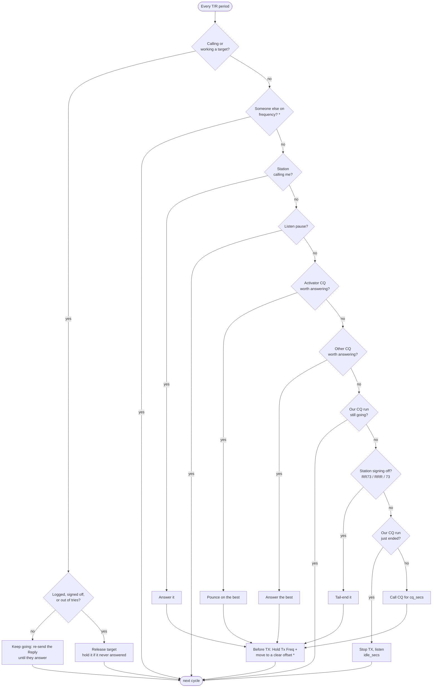

# FT8 Hunter

Automated FT8 / FT4 / FT2 operating for WSJT-X / WS Digital Suite: **make as many
contacts as possible without being rude on the band.** It follows whatever mode WS
is in; all timing rules scale with the mode's period.

Each T/R period (15 s FT8, 7.5 s FT4, 3.75 s FT2) it does the first of these that applies:

1. Answer a station calling you.
2. Pounce on an activator (CQ POTA / SOTA / WWFF / IOTA / BOTA / LOTA).
3. Answer any other CQ.
4. Tail-end a station signing off.
5. Call CQ for a while, then stop and listen.

CQs are ranked by chance of a contact: SNR, minus 3 dB for each station already
calling them, plus 3 if heard last period.

To stay polite it limits retries (counted in transmissions), holds off stations that
don't answer, stops the moment its target picks someone else, never abandons a QSO
in progress, only tail-ends sign-offs, skips stations already in a QSO, answers
`CQ DX` only from another continent, transmits on a clear offset instead of on top
of the station it calls, and backs off when someone else (SSB, CW…) is using the
frequency.



"Worth answering" means: heard in the last two periods, not already worked today or on
hold, not in a QSO with someone since that CQ, at or above the minimum SNR, not a
CQ aimed at a region, and for `CQ DX` on another continent. Between cycles, each
decode can also end a target early: if it answers someone else the hunter stops
calling, and a new caller replaces a target that hasn't answered yet.

\* needs the [ws-hunter](#ws-build-with-hunter-controls) build of WS.

## Run

```bash
python3 ft8_server.py --mycall YOURCALL --mygrid YOURGRID --port 2237 --http 8080   # stdlib only
# open http://localhost:8080/ (mobile-friendly UI)
```

In WS / WSJT-X, open Settings → Reporting, set the UDP server to `127.0.0.1:2237`
and tick **Accept UDP requests**. You can change retries, hold time, CQ and listen
times live from the Settings panel in the UI.

Offline tests (no radio needed): `python3 test_hunter.py`

### WS build with hunter controls

Stock WS has no UDP command to set the Tx offset or Enable Tx, so the hunter can
only *suggest* a clear offset and falls back to an xdotool click to arm TX. The
[ws-hunter](https://github.com/TheBengineer/ws-hunter) fork of WS adds those
controls plus a per-cycle spectrum feed; the hunter detects it automatically.

```bash
git clone https://github.com/TheBengineer/ws-hunter ~/ws-hunter
~/ws-hunter/build-hunter.sh        # installs to ~/ws-hunter-app; run ~/ws-hunter-app/bin/ws
```

## How it works

- **Decode feed**: passive `SO_REUSEPORT` listener on 2237. WSJT-X never binds 2237
  itself — it sends *from* an ephemeral port, so Replies must go back to that port
  (learned automatically from WS's own packets).
- **Reply = click**: a Type 4 Reply is only honored if every field (time, SNR, DT,
  DF, `~` mode marker, message) exactly matches a prior decode — same as clicking a
  line in the decode window. Params come from live Type 2 packets, never guessed.
- **TX control**: WS auto-sequences once armed. The hunter sends Halt Tx (type 8)
  when a target times out or is skipped.
- **Clear offset** (ws-hunter build): before answering or calling CQ it ticks Hold
  Tx Freq and moves to the widest gap on the period it will transmit in, judged
  from recent decodes and the spectrum; it stays put while that spot is clear.
- **Someone else on frequency** (ws-hunter build): wide undecoded energy in the
  spectrum for two cycles running pauses new calls for 5 minutes.
- **WRL Desktop bridge**: every WS packet is rebroadcast to `127.0.0.1:2238` — set
  WRL Desktop's UDP server to that port — and whatever WRL sends back is relayed to
  WS, so WRL logs as if it were talking to WS directly. (Two apps can't share 2237:
  Linux REUSEPORT *load-balances*, so they'd each miss half the traffic.)
