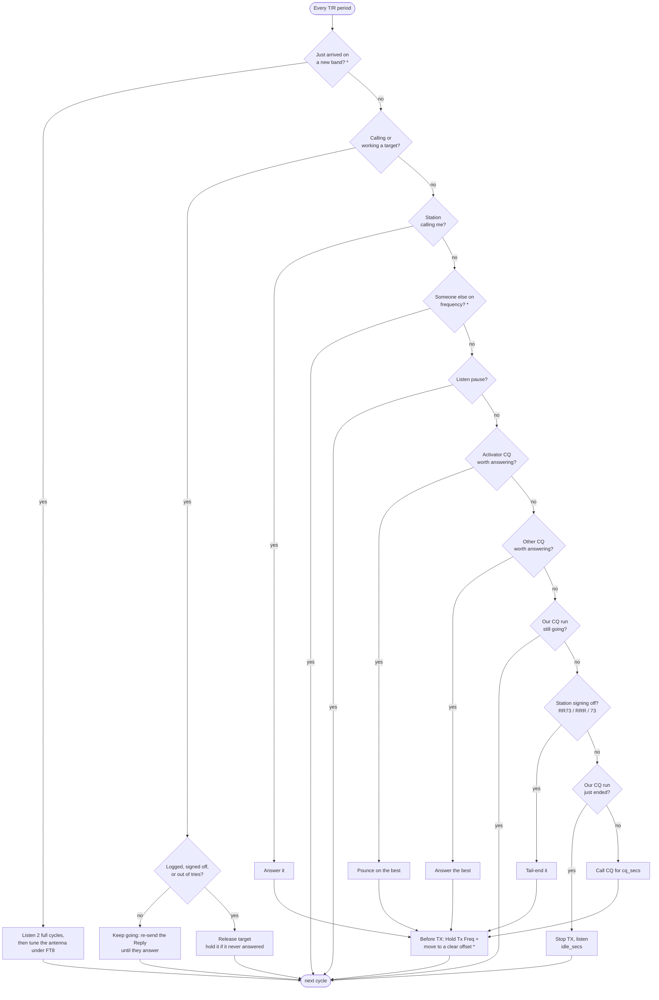

# FT8 Hunter

Automated FT8 / FT4 / FT2 operating for WSJT-X / WS Digital Suite: **make as many
contacts as possible without being rude on the band.** It follows whatever mode WS
is in; all timing rules scale with the mode's period.

Each T/R period (15 s FT8, 7.5 s FT4, 3.75 s FT2) it does the first of these that applies:

1. Answer stations calling you — when several answer your CQ it works them all,
   in the order they called, moving to the next as soon as you send RR73. A
   station that repeats its R-report after you logged it never copied your RR73,
   so it gets another one (up to 3, within 4 minutes) to complete its log too.
2. Pounce on an activator (CQ POTA / SOTA / WWFF / IOTA / BOTA / LOTA).
3. Answer any other CQ.
4. Tail-end a station signing off.
5. Call CQ for a while, then stop and listen.

**CQ first** (the 📣 button) turns the hunter into a runner: it calls CQ and works
everyone who answers, still leaves its CQ for an activator if "Activations first"
is on, and skips steps 3 and 4.

CQs are ranked by chance of a contact: SNR, minus 3 dB for each station already
calling them, plus 3 if heard last period.

To stay polite it limits retries (counted in transmissions), holds off stations that
don't answer, stops the moment its target picks someone else, gives up on a QSO
in progress only after 7 replies without an answer (a setting), only tail-ends sign-offs, skips stations already in a QSO, answers
`CQ DX` only from another continent, transmits on a clear offset instead of on top
of the station it calls, and backs off when someone else (SSB, CW…) is using the
frequency.



"Worth answering" means: heard in the last two periods, not already worked today or on
hold on this band and mode (a station worked on 20m FT8 can still be worked on 20m
FT4 or 40m FT8, and a hold on one doesn't apply to the others), not in a QSO with someone since that CQ, at or above the minimum SNR, not a
CQ aimed at a region, and for `CQ DX` on another continent. Between cycles, each
decode can also end a target early: if it answers someone else the hunter stops
calling, and a new caller replaces a target that hasn't answered yet. A station
calling you is always answered: holds, listen pauses and the busy-frequency backoff
only stop the hunter starting something new.

\* needs the [ws-hunter](#ws-build-with-hunter-controls) build of WS.

The web UI draws this same flow and lights up the step the hunter is on, with
the steps it passed marked "no". A waterfall (ws-hunter build) shows the last 40
periods with the decodes boxed, so undecoded signals stand out, and bars marking
which offsets the picker counts as taken on the even and odd periods; tap a spot
to see who is there and move your Tx offset to it. Each CQ shows why it is or isn't being called
(on hold, in QSO, pileup size, stale, weak, region/DX-only), and calls on hold
are underlined wherever they appear. A spinning globe draws today's contacts as
arcs from your station, the current target in bold and other stations' live
traffic faintly; during a QSO it zooms in on that QSO's arc. Scroll or pinch to
zoom it yourself. The worked / ignored list shows today's
contacts and the stations that never answered, with time, band and mode. On a desktop the cards spread into two or
three columns; move cards with the arrows or by dragging, and each stays in the
column you put it in.

### Changing band

When WS moves to another band (from the band scan's **Go**, or by hand while the
hunter runs), the hunter does two things before it transmits there.

1. **It listens for two full cycles**: two even and two odd periods, 60 s in
   FT8. The offset picker then has the last two periods of each parity, so its
   first transmission on the band goes on a clear offset. Listening needs no
   tune, so the antenna is left alone until now.
2. **It tunes the antenna** (Xiegu G90), just before the first transmission.
   It halts WS and moves 1 kHz below that band's FT8 frequency, which keeps the
   carrier clear of everyone on FT8 above the dial. It starts the rig's tuner,
   waits for it to finish, and goes back to the operating frequency. If the
   radio can't be confirmed on the tune frequency, nothing is sent. The periods
   spent tuning are left out of the offset picker, like periods we transmit in.

With the hunter stopped, nothing is tuned.

Changing band is meant to be an occasional, deliberate move, so **Go** refuses
to change band in the middle of a QSO. A mode change on the same band does neither. Both the tune and the distance below
FT8 are in Settings.

### Band scan

The 📶 Band scan card (ws-hunter build) checks which bands have traffic. Choose
the bands and modes and press **Scan bands**. The hunter visits each published
FT8 / FT4 / FT2 dial frequency (60m's 5357 kHz once, for all three modes). It
takes one clean spectrum at each and then puts WS back on the mode and frequency
it started on. WS runs FT2 during the scan, which gives a spectrum every 3.75 s.
The period in which the rig retuned is thrown away, so each stop takes about
7.5 s, and the full 27-stop HF scan takes about 3½ minutes. Hunting pauses for
the scan and resumes after it. A scan won't start in the middle of a QSO.

The frequencies come from WS's own default list (`models/FrequencyList.cpp`). The
hunter downloads it from GitHub once a day and caches it in `scan_freqs.json`.
That way new or moved FT2 frequencies arrive without a hunter update. If the
download fails, the hunter uses the same list built in. (Older WS settings keep
the frequency table they were saved with. In WS, Settings → Frequencies →
right-click → Reset loads the FT2 entries, but it also drops any frequencies you
added yourself.)

Each result shows the following:

- **Signals** are FT-like signals: runs of bins 2+ dB above the local quiet
  level (the 25th percentile within ±150 Hz), 30–300 Hz wide, 4+ dB at the
  peak, with the same level on both sides. The count and median strength are
  shown. Narrow 1–2 bin spikes count as carriers (birdies, CW) instead.
- **QRM** is wideband interference: a lump in the quiet level. The radio's own
  passband shape is the same on every band, so the median shape across all
  scanned frequencies is subtracted first. Whatever lump is left belongs to that
  band. Dense FT traffic also lifts the quiet level, so the lump only counts
  where signals cover under 30% of the passband.
- **Noise** is the floor compared with the scan's median. The low bands are
  naturally noisier. A frequency 10+ dB over the rest with only weak signals
  (under 6 dB) is labelled **noisy**.
- **Labels:** QRM with fewer than 3 signals is labelled QRM. Otherwise the label
  is busy (10+ signals), active (3+) or quiet.
- **Worked** shows how long ago you last logged a QSO on that band and mode
  (from the whole WS log), and how many in the last 24 h.
- A small chart shows dB over the floor from 200 to 3000 Hz, with the signals
  and carriers marked. FT2 stops also count what WS decoded.

Sort the results by band, by activity or by least recently worked. **Go** tunes
WS to that frequency and mode. Results are kept in `scan_results.json` across
restarts.

## Run

```bash
python3 ft8_server.py --mycall YOURCALL --mygrid YOURGRID --port 2237 --http 8080   # stdlib only
# open http://localhost:8080/ (mobile-friendly UI)
```

In WS / WSJT-X, open Settings → Reporting, set the UDP server to `127.0.0.1:2237`
and tick **Accept UDP requests**. You can change retries, hold time, CQ and listen
times live from the Settings panel in the UI.

Offline tests (no radio needed): `python3 test_hunter.py`

### WS build with hunter controls

Stock WS has no UDP command to set the Tx offset, Enable Tx or clear the DX call,
so the hunter can only *suggest* a clear offset, falls back to an xdotool click to
arm TX, and can't reliably switch WS from the last station back to CQ. The
[ws-hunter](https://github.com/TheBengineer/ws-hunter) fork of WS adds those
controls plus a per-cycle spectrum feed; the hunter detects it automatically.

```bash
git clone https://github.com/TheBengineer/ws-hunter ~/ws-hunter
~/ws-hunter/build-hunter.sh        # installs to ~/ws-hunter-app; run ~/ws-hunter-app/bin/ws
```

## How it works

- **Decode feed**: passive `SO_REUSEPORT` listener on 2237. WSJT-X never binds 2237
  itself — it sends *from* an ephemeral port, so Replies must go back to that port
  (learned automatically from WS's own packets).
- **Reply = click**: a Type 4 Reply is only honored if every field (time, SNR, DT,
  DF, `~` mode marker, message) exactly matches a prior decode — same as clicking a
  line in the decode window. Params come from live Type 2 packets, never guessed.
- **TX control**: WS auto-sequences once armed. The hunter sends Halt Tx (type 8)
  when a target times out or is skipped. To call CQ it sends ClearDX (ws-hunter
  type 28, which empties DX Call and selects Tx6) and then Enable Tx, and checks
  WS's Status that the next message really is the CQ.
- **Clear offset** (ws-hunter build): before answering or calling CQ it ticks Hold
  Tx Freq and moves to the widest gap on the period it will transmit in, judged
  from the decodes and spectrum of that period's last two cycles only (a station
  that gave up a frequency before then no longer counts); it stays put while
  that spot is clear.
  The spectrum test compares each 10 Hz bin with its usual quiet level (learned
  over the last few minutes, so the receiver's passband slope doesn't count), so
  a station too weak to decode here, about -20 dB and up, still marks its spot
  taken: it may be strong at the far end.
  It never picks below the lowest offset in Settings (default 1300 Hz, for rigs
  that feed back on low audio tones). Settings are saved in `hunter_config.json`.
- **Someone else on frequency** (ws-hunter build): wide undecoded energy in the
  spectrum for two cycles running pauses new calls for 5 minutes.
- **Radio power**: the status card sets TX power through FLRig's XML-RPC server
  (`--flrig`, default `http://127.0.0.1:12345`), and shows the strongest decode
  of the last period as the incoming signal. Power has two settings: **calling**
  (default 10 W, also used for CQ) and **in QSO** (default 20 W), switched up as
  soon as the station answers and back down once the QSO is over. The slider sets
  the one for the stage you're in; both are also in Settings. The power is held:
  if the radio's setting changes behind the hunter's back it is set back (and
  logged). On the G90, FLRig's `get_power` reads 0, so the setting is read with a
  raw CI-V query instead. A thin bar shows output power while transmitting (the
  G90's meter is coarse: full or nothing).
- **SWR, relative** (G90): the G90 answers the CI-V SWR-meter query with a raw
  number that rises with the power setting and tops out at 20 W, and FLRig clips
  it. Its scale is unknown and the radio shows SWR only as a bar, so the number
  isn't turned into an SWR. Instead each transmission's reading is kept in
  `swr_log.json` (band, power, reading), and the status card compares the reading
  with the usual one for that band and power: **normal**, **higher than usual**
  (1.2× or more) or **much higher: check the antenna** (1.5× or more). It needs
  three transmissions on a band at a power before it judges; antenna tunes don't
  count.
- **WRL Desktop bridge**: every WS packet is rebroadcast to `127.0.0.1:2238` — set
  WRL Desktop's UDP server to that port — and whatever WRL sends back is relayed to
  WS, so WRL logs as if it were talking to WS directly. (Two apps can't share 2237:
  Linux REUSEPORT *load-balances*, so they'd each miss half the traffic.)
